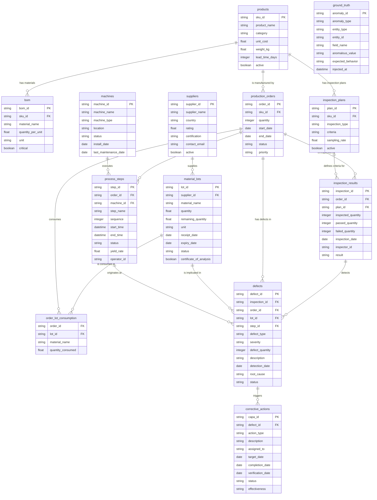

# Manufacturing Defect Traceability System — Data Dictionary

> **Document Version:** 1.0  
> **Last Updated:** 2026-10-29  
> **Classification:** Internal — Quality System Documentation  
> **Applicable Standard:** Supports ISO 9001:2015 Clause 7.5 — Documented Information

---

## Table of Contents

1. [Overview](#overview)
2. [Conventions & Notation](#conventions--notation)
3. [Table Definitions](#table-definitions)
   - 3.1  [products.csv — Product Master](#31-productscsv--product-master)
   - 3.2  [bom.csv — Bill of Materials](#32-bomcsv--bill-of-materials)
   - 3.3  [suppliers.csv — Supplier Registry](#33-supplierscsv--supplier-registry)
   - 3.4  [material_lots.csv — Material Lot Tracking](#34-material_lotscsv--material-lot-tracking)
   - 3.5  [production_orders.csv — Production / Work Orders](#35-production_orderscsv--production--work-orders)
   - 3.6  [order_lot_consumption.csv — Order–Lot Consumption Bridge](#36-order_lot_consumptioncsv--orderlot-consumption-bridge)
   - 3.7  [machines.csv — Machine / Equipment Registry](#37-machinescsv--machine--equipment-registry)
   - 3.8  [process_steps.csv — Process Step Records](#38-process_stepscsv--process-step-records)
   - 3.9  [inspection_plans.csv — Inspection Plan Definitions](#39-inspection_planscsv--inspection-plan-definitions)
   - 3.10 [inspection_results.csv — Inspection Result Records](#310-inspection_resultscsv--inspection-result-records)
   - 3.11 [defects.csv — Defect Log](#311-defectscsv--defect-log)
   - 3.12 [corrective_actions.csv — CAPA Records](#312-corrective_actionscsv--capa-records)
   - 3.13 [ground_truth.csv — Anomaly Ground Truth](#313-ground_truthcsv--anomaly-ground-truth)
4. [Entity-Relationship Summary](#entity-relationship-summary)
5. [Cross-Table Business Rules](#cross-table-business-rules)
6. [Appendix — Enum Value Reference](#appendix--enum-value-reference)

---

## Overview

This data dictionary defines every field across all **13 tables** of the Manufacturing Defect Traceability System. The system provides end-to-end traceability from raw-material receipt through production, inspection, defect detection, and corrective action — supporting root-cause analysis, regulatory compliance, and continuous improvement initiatives.

The tables collectively form a directed acyclic graph (DAG) of traceability links:

```
Products ──► BOM
Products ──► Production Orders ──► Process Steps
Products ──► Inspection Plans
Suppliers ──► Material Lots ──► Order-Lot Consumption ◄── Production Orders
Machines ──► Process Steps
Inspection Plans ──► Inspection Results ◄── Production Orders
Inspection Results ──► Defects ◄── Material Lots, Process Steps, Production Orders
Defects ──► Corrective Actions
```

---

## Conventions & Notation

| Symbol / Term      | Meaning                                                                 |
|:-------------------|:------------------------------------------------------------------------|
| **PK**             | Primary Key — uniquely identifies each row                              |
| **FK**             | Foreign Key — references the primary key of another table               |
| **CK**             | Composite Key — uniqueness enforced across multiple columns together    |
| **Required**       | Field must be non-null and non-empty in every record                    |
| **Optional**       | Field may be null / blank under documented conditions                   |
| `NNNNNN`           | Zero-padded 6-digit integer (e.g., `000001`)                           |
| `NNNN`             | Zero-padded 4-digit integer (e.g., `0001`)                             |
| `NNN`              | Zero-padded 3-digit integer (e.g., `001`)                              |
| `YYYY`             | 4-digit calendar year                                                   |
| **date**           | ISO 8601 date format `YYYY-MM-DD`                                       |
| **datetime**       | ISO 8601 datetime format `YYYY-MM-DDTHH:MM:SS` (local or UTC)          |
| **boolean**        | Logical true/false (serialized as `True` / `False` in CSV)              |
| **float**          | Decimal number (IEEE 754 double precision)                              |
| **integer**        | Whole number (no decimal component)                                     |
| **string**         | UTF-8 text                                                              |

---

## Table Definitions

---

### 3.1 `products.csv` — Product Master

> **Purpose:** Central registry of all finished goods or sub-assemblies produced by the facility. Every production order, BOM, and inspection plan references a product by its SKU.

| # | Field Name        | Data Type | Required | Unique | Allowed Values / Format                       | Units | Description                                        |
|--:|:------------------|:----------|:---------|:-------|:----------------------------------------------|:------|:---------------------------------------------------|
| 1 | `sku_id`          | string    | Yes      | Yes (PK) | `SKU-NNNNNN` (e.g., `SKU-000042`)           | —     | Primary key. Unique product stock-keeping-unit identifier. |
| 2 | `product_name`    | string    | Yes      | No     | Free text                                      | —     | Human-readable descriptive name of the product.    |
| 3 | `category`        | string    | Yes      | No     | **Enum** — see [Product Categories](#product-categories) | — | Product classification category.                 |
| 4 | `unit_cost`       | float     | Yes      | No     | Range: `10.00` – `5000.00`                     | USD   | Manufacturing cost per unit.                       |
| 5 | `weight_kg`       | float     | Yes      | No     | Range: `0.01` – `500.00`                       | kg    | Net weight of one finished unit.                   |
| 6 | `lead_time_days`  | integer   | Yes      | No     | Range: `1` – `90`                              | days  | Standard manufacturing lead time in calendar days. |
| 7 | `active`          | boolean   | Yes      | No     | `True` / `False`                               | —     | Whether the product is currently active in the catalog. Inactive products cannot have new production orders. |

**Validation Rules:**
- `sku_id` must match regex: `^SKU-\d{6}$`
- `unit_cost` must be ≥ 10.00 and ≤ 5000.00
- `weight_kg` must be ≥ 0.01 and ≤ 500.00
- `lead_time_days` must be a positive integer between 1 and 90 inclusive

**Foreign Key Relationships:**
- Referenced by: `bom.sku_id`, `production_orders.sku_id`, `inspection_plans.sku_id`

---

### 3.2 `bom.csv` — Bill of Materials

> **Purpose:** Defines the raw materials and components required to manufacture each product. Each row maps one material to one product with the required quantity per finished unit.

| # | Field Name          | Data Type | Required | Unique | Allowed Values / Format         | Units | Description                                          |
|--:|:--------------------|:----------|:---------|:-------|:--------------------------------|:------|:-----------------------------------------------------|
| 1 | `bom_id`            | string    | Yes      | Yes (PK) | `BOM-NNNNNN` (e.g., `BOM-000100`) | —  | Primary key. Unique bill-of-materials line identifier.|
| 2 | `sku_id`            | string    | Yes      | No     | Must exist in `products.sku_id` | —     | FK → `products.sku_id`. The product this material belongs to. |
| 3 | `material_name`     | string    | Yes      | No     | Free text                        | —     | Descriptive name of the raw material or component.   |
| 4 | `quantity_per_unit`  | float     | Yes      | No     | Must be > 0                      | (varies) | Quantity of this material required to produce one unit of the product. Unit defined by `unit` field. |
| 5 | `unit`              | string    | Yes      | No     | **Enum:** `kg`, `m`, `pcs`, `L`, `g` | — | Unit of measure for the material quantity.           |
| 6 | `critical`          | boolean   | Yes      | No     | `True` / `False`                 | —     | Whether this material is a critical component. Critical components require enhanced traceability and incoming inspection. |

**Validation Rules:**
- `bom_id` must match regex: `^BOM-\d{6}$`
- `sku_id` must reference an existing product in `products.csv`
- `quantity_per_unit` must be strictly greater than 0
- `unit` must be one of the five enumerated values

**Foreign Key Relationships:**
- `sku_id` → `products.sku_id`
- Referenced by: Used for traceability cross-checks with `order_lot_consumption.material_name`

> [!NOTE]
> A single product (`sku_id`) may have multiple BOM entries (one per required material). The combination of `sku_id` + `material_name` should be logically unique, though the primary key is `bom_id`.

---

### 3.3 `suppliers.csv` — Supplier Registry

> **Purpose:** Master list of all approved material suppliers. Supplier records are referenced by material lots to establish supply-chain traceability.

| # | Field Name       | Data Type | Required | Unique | Allowed Values / Format       | Units | Description                                        |
|--:|:-----------------|:----------|:---------|:-------|:------------------------------|:------|:---------------------------------------------------|
| 1 | `supplier_id`    | string    | Yes      | Yes (PK) | `SUP-NNNNNN` (e.g., `SUP-000005`) | — | Primary key. Unique supplier identifier.          |
| 2 | `supplier_name`  | string    | Yes      | No     | Free text                      | —     | Registered company name of the supplier.           |
| 3 | `country`        | string    | Yes      | No     | Country name (English)         | —     | Country where the supplier is headquartered.       |
| 4 | `rating`         | float     | Yes      | No     | Range: `1.0` – `5.0`          | —     | Composite supplier performance rating (1 = poor, 5 = excellent). |
| 5 | `certification`  | string    | Yes      | No     | Free text (e.g., `ISO 9001`, `IATF 16949`, `AS9100`) | — | Quality management system certification held by the supplier. |
| 6 | `contact_email`  | string    | Yes      | No     | Valid email address format      | —     | Primary point-of-contact email address.            |
| 7 | `active`         | boolean   | Yes      | No     | `True` / `False`               | —     | Whether the supplier is approved and active. Inactive suppliers should not have new lots received. |

**Validation Rules:**
- `supplier_id` must match regex: `^SUP-\d{6}$`
- `rating` must be ≥ 1.0 and ≤ 5.0
- `contact_email` must match standard email format (contains `@` and valid domain)

**Foreign Key Relationships:**
- Referenced by: `material_lots.supplier_id`

---

### 3.4 `material_lots.csv` — Material Lot Tracking

> **Purpose:** Tracks every discrete batch/lot of raw material received from suppliers. Enables lot-level traceability from supplier delivery through production consumption.

| # | Field Name                | Data Type | Required | Unique | Allowed Values / Format                          | Units    | Description                                          |
|--:|:--------------------------|:----------|:---------|:-------|:-------------------------------------------------|:---------|:-----------------------------------------------------|
| 1 | `lot_id`                  | string    | Yes      | Yes (PK) | `LOT-SUP-NNNNNN-YYYY-NNNNNN` (e.g., `LOT-SUP-000005-2026-000312`) | — | Primary key. Encodes supplier ID, year, and sequence. |
| 2 | `supplier_id`             | string    | Yes      | No     | Must exist in `suppliers.supplier_id`             | —        | FK → `suppliers.supplier_id`. Supplier who shipped this lot. |
| 3 | `material_name`           | string    | Yes      | No     | Free text                                         | —        | Name of the raw material in this lot. Should match a `bom.material_name`. |
| 4 | `quantity`                | float     | Yes      | No     | Must be > 0                                       | (varies) | Original received quantity of the lot.               |
| 5 | `remaining_quantity`      | float     | Yes      | No     | Must be ≥ 0; must be ≤ `quantity`                 | (varies) | **Calculated field:** `quantity` minus total consumed across all production orders. |
| 6 | `unit`                    | string    | Yes      | No     | **Enum:** `kg`, `m`, `pcs`, `L`, `g`             | —        | Unit of measure. Must be consistent with BOM unit for the same material. |
| 7 | `receipt_date`            | date      | Yes      | No     | `YYYY-MM-DD`                                      | —        | Date the lot was physically received at the plant.   |
| 8 | `expiry_date`             | date      | Optional | No     | `YYYY-MM-DD`; must be > `receipt_date` when present | —     | Material expiration date. Null if material does not expire. |
| 9 | `status`                  | string    | Yes      | No     | **Enum:** `Available`, `In Use`, `Depleted`, `Quarantined`, `Expired` | — | Current disposition status of the lot. |
| 10| `certificate_of_analysis` | boolean   | Yes      | No     | `True` / `False`                                  | —        | Whether a Certificate of Analysis (CoA) was received and filed for this lot. |

**Validation Rules:**
- `lot_id` must match regex: `^LOT-SUP-\d{6}-\d{4}-\d{6}$`
- `supplier_id` must reference an existing supplier in `suppliers.csv`
- `remaining_quantity` = `quantity` − Σ(`order_lot_consumption.quantity_consumed` where `lot_id` matches)
- `remaining_quantity` must be ≥ 0
- If `expiry_date` is populated, it must be strictly after `receipt_date`
- If `status` = `Expired`, then `expiry_date` should be in the past
- If `remaining_quantity` = 0, then `status` should be `Depleted`

**Foreign Key Relationships:**
- `supplier_id` → `suppliers.supplier_id`
- Referenced by: `order_lot_consumption.lot_id`, `defects.lot_id`

> [!IMPORTANT]
> The `remaining_quantity` field is a **calculated/derived field**. Its value must equal the original `quantity` minus the sum of all `quantity_consumed` entries in `order_lot_consumption.csv` for that `lot_id`. Any discrepancy indicates a data integrity issue.

---

### 3.5 `production_orders.csv` — Production / Work Orders

> **Purpose:** Represents discrete manufacturing work orders. Each order corresponds to a batch of a single product being manufactured on the production floor.

| # | Field Name   | Data Type | Required | Unique | Allowed Values / Format                                   | Units | Description                                        |
|--:|:-------------|:----------|:---------|:-------|:----------------------------------------------------------|:------|:---------------------------------------------------|
| 1 | `order_id`   | string    | Yes      | Yes (PK) | `WO-YYYY-NNNNNN` (e.g., `WO-2026-001234`)              | —     | Primary key. Work order identifier with embedded year. |
| 2 | `sku_id`     | string    | Yes      | No     | Must exist in `products.sku_id`                            | —     | FK → `products.sku_id`. Product being manufactured. |
| 3 | `quantity`   | integer   | Yes      | No     | Range: `1` – `1000`                                       | units | Number of product units ordered for production.    |
| 4 | `start_date` | date      | Yes      | No     | `YYYY-MM-DD`                                               | —     | Planned or actual production start date.           |
| 5 | `end_date`   | date      | Yes      | No     | `YYYY-MM-DD`; must be ≥ `start_date`                      | —     | Planned or actual production end date.             |
| 6 | `status`     | string    | Yes      | No     | **Enum:** `Planned`, `In Progress`, `Completed`, `On Hold`, `Cancelled` | — | Current status of the work order. |
| 7 | `priority`   | string    | Yes      | No     | **Enum:** `Low`, `Normal`, `High`, `Urgent`                | —     | Scheduling priority level.                         |

**Validation Rules:**
- `order_id` must match regex: `^WO-\d{4}-\d{6}$`
- `sku_id` must reference an existing product in `products.csv`
- `quantity` must be a positive integer between 1 and 1000 inclusive
- `end_date` must be ≥ `start_date`
- `start_date` must be ≥ `receipt_date` for all material lots consumed by this order (cross-table rule)

**Foreign Key Relationships:**
- `sku_id` → `products.sku_id`
- Referenced by: `order_lot_consumption.order_id`, `process_steps.order_id`, `inspection_results.order_id`, `defects.order_id`

---

### 3.6 `order_lot_consumption.csv` — Order–Lot Consumption Bridge

> **Purpose:** Many-to-many bridge table linking production orders to the specific material lots consumed during manufacturing. Essential for forward and backward lot traceability.

| # | Field Name          | Data Type | Required | Unique | Allowed Values / Format                     | Units    | Description                                        |
|--:|:--------------------|:----------|:---------|:-------|:--------------------------------------------|:---------|:---------------------------------------------------|
| 1 | `order_id`          | string    | Yes      | No     | Must exist in `production_orders.order_id`   | —        | FK → `production_orders.order_id`. The work order that consumed material. |
| 2 | `lot_id`            | string    | Yes      | No     | Must exist in `material_lots.lot_id`         | —        | FK → `material_lots.lot_id`. The specific lot from which material was drawn. |
| 3 | `material_name`     | string    | Yes      | No     | Free text                                    | —        | Name of the material consumed. Should match both `material_lots.material_name` and a `bom.material_name` for the order's product. |
| 4 | `quantity_consumed` | float     | Yes      | No     | Must be > 0                                  | (varies) | Amount of material consumed from the specified lot. |

**Key Constraints:**

| Constraint Type | Definition                                                               |
|:----------------|:-------------------------------------------------------------------------|
| **Composite Key (CK)** | `(order_id, lot_id, material_name)` — each combination must be unique |
| **Aggregate Constraint** | Σ `quantity_consumed` for a given `lot_id` must be ≤ `material_lots.quantity` for that lot |

**Validation Rules:**
- `order_id` must reference an existing production order in `production_orders.csv`
- `lot_id` must reference an existing material lot in `material_lots.csv`
- `quantity_consumed` must be strictly greater than 0
- The total consumption per lot (across all orders) must not exceed the lot's original `quantity`
- `material_name` should be consistent with the referenced lot's `material_name`

**Foreign Key Relationships:**
- `order_id` → `production_orders.order_id`
- `lot_id` → `material_lots.lot_id`

> [!TIP]
> To trace all raw materials used in a specific production run, join `order_lot_consumption` with `material_lots` and then with `suppliers` to obtain full supply-chain provenance.

---

### 3.7 `machines.csv` — Machine / Equipment Registry

> **Purpose:** Master list of all manufacturing equipment on the shop floor. Machines are assigned to individual process steps for equipment-level traceability.

| # | Field Name              | Data Type | Required | Unique | Allowed Values / Format                                      | Units | Description                                        |
|--:|:------------------------|:----------|:---------|:-------|:-------------------------------------------------------------|:------|:---------------------------------------------------|
| 1 | `machine_id`            | string    | Yes      | Yes (PK) | `MCH-NNNNNN` (e.g., `MCH-000015`)                          | —     | Primary key. Unique machine/equipment identifier.  |
| 2 | `machine_name`          | string    | Yes      | No     | Free text                                                     | —     | Descriptive name of the machine.                   |
| 3 | `machine_type`          | string    | Yes      | No     | **Enum:** `CNC`, `Press`, `Injection Molding`, `Assembly`, `Welding`, `Testing`, `Surface Treatment`, `SMT` | — | Classification of the machine type. |
| 4 | `location`              | string    | Yes      | No     | Free text (e.g., `Plant A - Line 3`)                         | —     | Physical location of the machine within the facility. |
| 5 | `status`                | string    | Yes      | No     | **Enum:** `Operational`, `Under Maintenance`, `Decommissioned` | —  | Current operational status of the machine.         |
| 6 | `install_date`          | date      | Yes      | No     | `YYYY-MM-DD`                                                  | —     | Date the machine was originally installed.         |
| 7 | `last_maintenance_date` | date      | Optional | No     | `YYYY-MM-DD`; must be ≥ `install_date` when present          | —     | Date of the most recent maintenance event. Null if no maintenance has been performed. |

**Validation Rules:**
- `machine_id` must match regex: `^MCH-\d{6}$`
- If `last_maintenance_date` is populated, it must be ≥ `install_date`
- If `status` = `Decommissioned`, the machine should not be assigned to new process steps

**Foreign Key Relationships:**
- Referenced by: `process_steps.machine_id`

---

### 3.8 `process_steps.csv` — Process Step Records

> **Purpose:** Records every discrete manufacturing operation performed on a production order. Steps are sequenced and each is linked to the specific machine and operator that executed it.

| # | Field Name    | Data Type | Required | Unique | Allowed Values / Format                            | Units | Description                                        |
|--:|:--------------|:----------|:---------|:-------|:---------------------------------------------------|:------|:---------------------------------------------------|
| 1 | `step_id`     | string    | Yes      | Yes (PK) | `STEP-WO-YYYY-NNNNNN-NNN` (e.g., `STEP-WO-2026-001234-001`) | — | Primary key. Embeds the parent order ID and step sequence. |
| 2 | `order_id`    | string    | Yes      | No     | Must exist in `production_orders.order_id`          | —     | FK → `production_orders.order_id`. The work order this step belongs to. |
| 3 | `machine_id`  | string    | Yes      | No     | Must exist in `machines.machine_id`                 | —     | FK → `machines.machine_id`. The machine used for this step. |
| 4 | `step_name`   | string    | Yes      | No     | Free text                                           | —     | Descriptive name of the manufacturing process step. |
| 5 | `sequence`    | integer   | Yes      | No     | 1-indexed positive integer                          | —     | Ordinal position of this step within the production order. Sequence values should be unique per `order_id`. |
| 6 | `start_time`  | datetime  | Yes      | No     | `YYYY-MM-DDTHH:MM:SS`; must be ≥ parent order's `start_date` | — | Timestamp when the step began execution.          |
| 7 | `end_time`    | datetime  | Yes      | No     | `YYYY-MM-DDTHH:MM:SS`; must be ≥ `start_time`     | —     | Timestamp when the step completed.                 |
| 8 | `status`      | string    | Yes      | No     | **Enum:** `Pending`, `In Progress`, `Completed`, `Failed`, `Skipped` | — | Current execution status of the step.          |
| 9 | `yield_rate`  | float     | Yes      | No     | Range: `0.0` – `100.0`                             | %     | Percentage of good output produced by this step.   |
| 10| `operator_id` | string    | Yes      | No     | `EMP-NNNN` (e.g., `EMP-0042`)                      | —     | Employee ID of the operator who executed the step. |

**Validation Rules:**
- `step_id` must match regex: `^STEP-WO-\d{4}-\d{6}-\d{3}$`
- `order_id` must reference an existing production order in `production_orders.csv`
- `machine_id` must reference an existing machine in `machines.csv`
- `end_time` must be ≥ `start_time`
- `start_time` (date portion) must be ≥ the parent order's `start_date`
- `yield_rate` must be ≥ 0.0 and ≤ 100.0
- `operator_id` must match regex: `^EMP-\d{4}$`
- `sequence` values must be unique within each `order_id` (no duplicate step numbers per order)

**Foreign Key Relationships:**
- `order_id` → `production_orders.order_id`
- `machine_id` → `machines.machine_id`
- Referenced by: `defects.step_id`

> [!NOTE]
> The `step_id` format embeds the parent `order_id` for human readability (e.g., `STEP-WO-2026-001234-001` belongs to `WO-2026-001234`). The trailing `NNN` corresponds to the step `sequence`.

---

### 3.9 `inspection_plans.csv` — Inspection Plan Definitions

> **Purpose:** Defines the inspection criteria and sampling requirements for each product. Plans are reusable templates that are applied to specific production order inspections.

| # | Field Name        | Data Type | Required | Unique | Allowed Values / Format                                 | Units | Description                                        |
|--:|:------------------|:----------|:---------|:-------|:--------------------------------------------------------|:------|:---------------------------------------------------|
| 1 | `plan_id`         | string    | Yes      | Yes (PK) | `PLAN-NNNNNN` (e.g., `PLAN-000010`)                   | —     | Primary key. Unique inspection plan identifier.    |
| 2 | `sku_id`          | string    | Yes      | No     | Must exist in `products.sku_id`                          | —     | FK → `products.sku_id`. The product this plan applies to. |
| 3 | `inspection_type` | string    | Yes      | No     | **Enum:** `Incoming Material`, `In-Process`, `Final`, `Dimensional`, `Visual`, `Functional`, `Destructive Test` | — | Classification of the inspection methodology. |
| 4 | `criteria`        | string    | Yes      | No     | Free text                                                | —     | Detailed description of the acceptance/rejection criteria. |
| 5 | `sampling_rate`   | float     | Yes      | No     | Range: `1.0` – `100.0`                                  | %     | Percentage of units from a production order to be inspected. |
| 6 | `active`          | boolean   | Yes      | No     | `True` / `False`                                         | —     | Whether this inspection plan is currently in effect. |

**Validation Rules:**
- `plan_id` must match regex: `^PLAN-\d{6}$`
- `sku_id` must reference an existing product in `products.csv`
- `sampling_rate` must be ≥ 1.0 and ≤ 100.0

**Foreign Key Relationships:**
- `sku_id` → `products.sku_id`
- Referenced by: `inspection_results.plan_id`

---

### 3.10 `inspection_results.csv` — Inspection Result Records

> **Purpose:** Captures the outcome of each inspection event performed against a production order. Links to the inspection plan used and records pass/fail quantities.

| # | Field Name           | Data Type | Required | Unique | Allowed Values / Format                                   | Units | Description                                        |
|--:|:---------------------|:----------|:---------|:-------|:----------------------------------------------------------|:------|:---------------------------------------------------|
| 1 | `inspection_id`      | string    | Yes      | Yes (PK) | `INSP-WO-YYYY-NNNNNN-NNN` (e.g., `INSP-WO-2026-001234-001`) | — | Primary key. Embeds the parent order ID.          |
| 2 | `order_id`           | string    | Yes      | No     | Must exist in `production_orders.order_id`                 | —     | FK → `production_orders.order_id`. The work order being inspected. |
| 3 | `plan_id`            | string    | Yes      | No     | Must exist in `inspection_plans.plan_id`                   | —     | FK → `inspection_plans.plan_id`. The inspection plan applied. |
| 4 | `inspected_quantity` | integer   | Yes      | No     | Must be > 0                                                | units | Number of units selected and inspected.            |
| 5 | `passed_quantity`    | integer   | Yes      | No     | Must be ≥ 0; must be ≤ `inspected_quantity`                | units | Number of units that met acceptance criteria.      |
| 6 | `failed_quantity`    | integer   | Yes      | No     | Must equal `inspected_quantity` − `passed_quantity`         | units | **Calculated field:** Number of units that failed inspection. |
| 7 | `inspection_date`    | date      | Yes      | No     | `YYYY-MM-DD`; must be ≥ parent order's `start_date`       | —     | Date the inspection was performed.                 |
| 8 | `inspector_id`       | string    | Yes      | No     | `EMP-NNNN` (e.g., `EMP-0100`)                             | —     | Employee ID of the quality inspector.              |
| 9 | `result`             | string    | Yes      | No     | **Enum:** `Pass`, `Fail`, `Conditional Pass`               | —     | Overall inspection verdict.                        |

**Validation Rules:**
- `inspection_id` must match regex: `^INSP-WO-\d{4}-\d{6}-\d{3}$`
- `order_id` must reference an existing production order in `production_orders.csv`
- `plan_id` must reference an existing inspection plan in `inspection_plans.csv`
- `passed_quantity` + `failed_quantity` must equal `inspected_quantity` exactly
- `passed_quantity` must be ≤ `inspected_quantity`
- `inspection_date` must be ≥ the parent order's `start_date`
- `inspector_id` must match regex: `^EMP-\d{4}$`

**Foreign Key Relationships:**
- `order_id` → `production_orders.order_id`
- `plan_id` → `inspection_plans.plan_id`
- Referenced by: `defects.inspection_id`

> [!IMPORTANT]
> The `failed_quantity` is a **derived field** and must always equal `inspected_quantity − passed_quantity`. Any deviation constitutes a data integrity violation.

---

### 3.11 `defects.csv` — Defect Log

> **Purpose:** Records every defect detected during inspection or production. Each defect is linked back to its inspection event, production order, material lot, and process step — forming the core of the traceability chain.

| # | Field Name       | Data Type | Required | Unique | Allowed Values / Format                            | Units | Description                                        |
|--:|:-----------------|:----------|:---------|:-------|:---------------------------------------------------|:------|:---------------------------------------------------|
| 1 | `defect_id`      | string    | Yes      | Yes (PK) | `DEF-YYYY-NNNNNN` (e.g., `DEF-2026-000050`)      | —     | Primary key. Unique defect record identifier.      |
| 2 | `inspection_id`  | string    | Yes      | No     | Must exist in `inspection_results.inspection_id`    | —     | FK → `inspection_results.inspection_id`. The inspection that detected this defect. |
| 3 | `order_id`       | string    | Yes      | No     | Must exist in `production_orders.order_id`          | —     | FK → `production_orders.order_id`. The work order where the defect occurred. |
| 4 | `lot_id`         | string    | Yes      | No     | FK → `material_lots.lot_id`                         | —     | Material lot implicated in the defect. **Note:** May reference a non-existent lot for intentionally injected anomalies. |
| 5 | `step_id`        | string    | Yes      | No     | FK → `process_steps.step_id`                        | —     | Process step where the defect originated. **Note:** May reference an invalid step for intentionally injected anomalies. |
| 6 | `defect_type`    | string    | Yes      | No     | Free text                                           | —     | Classification of the defect type (e.g., `Dimensional Out-of-Spec`, `Surface Crack`). |
| 7 | `severity`       | string    | Yes      | No     | **Enum:** `Critical`, `Major`, `Minor`, `Cosmetic`  | —     | Impact severity classification.                    |
| 8 | `defect_quantity` | integer   | Yes      | No     | Must be > 0; normally ≤ parent inspection's `failed_quantity` | units | Number of defective units associated with this defect record. |
| 9 | `description`    | string    | Yes      | No     | Free text                                           | —     | Detailed narrative description of the defect.      |
| 10| `detection_date` | date      | Yes      | No     | `YYYY-MM-DD`; must be ≥ parent inspection's `inspection_date` | — | Date the defect was formally recorded.           |
| 11| `root_cause`     | string    | Optional | No     | Free text                                           | —     | Identified root cause. Null if investigation is still ongoing. |
| 12| `status`         | string    | Yes      | No     | **Enum:** `Open`, `Under Investigation`, `Contained`, `Resolved` | — | Current lifecycle status of the defect.          |

**Validation Rules:**
- `defect_id` must match regex: `^DEF-\d{4}-\d{6}$`
- `inspection_id` must reference an existing inspection in `inspection_results.csv`
- `order_id` must reference an existing production order in `production_orders.csv`
- `defect_quantity` must be > 0
- Under normal (non-anomalous) conditions, `defect_quantity` should be ≤ the parent inspection's `failed_quantity`
- `detection_date` must be ≥ the parent inspection's `inspection_date`
- If `status` = `Resolved`, a `root_cause` should ideally be populated

**Foreign Key Relationships:**
- `inspection_id` → `inspection_results.inspection_id`
- `order_id` → `production_orders.order_id`
- `lot_id` → `material_lots.lot_id` (soft reference — may be broken for anomaly records)
- `step_id` → `process_steps.step_id` (soft reference — may be broken for anomaly records)
- Referenced by: `corrective_actions.defect_id`

> [!WARNING]
> The `lot_id` and `step_id` fields may intentionally reference **non-existent** entities in the anomaly/ground-truth dataset. This is by design to test traceability validation logic. In production data, these must always be valid foreign keys.

---

### 3.12 `corrective_actions.csv` — CAPA Records

> **Purpose:** Captures Corrective and Preventive Actions (CAPA) linked to specific defects. Tracks the full lifecycle from initiation through verification of effectiveness — a critical quality management system requirement.

| # | Field Name          | Data Type | Required    | Unique | Allowed Values / Format                                  | Units | Description                                        |
|--:|:--------------------|:----------|:------------|:-------|:---------------------------------------------------------|:------|:---------------------------------------------------|
| 1 | `capa_id`           | string    | Yes         | Yes (PK) | `CAPA-YYYY-NNNNNN` (e.g., `CAPA-2026-000020`)          | —     | Primary key. Unique CAPA record identifier.        |
| 2 | `defect_id`         | string    | Yes         | No     | Must exist in `defects.defect_id`                         | —     | FK → `defects.defect_id`. The defect this action addresses. |
| 3 | `action_type`       | string    | Yes         | No     | **Enum:** `Containment`, `Root Cause Analysis`, `Corrective Action`, `Preventive Action`, `Design Change`, `Process Change`, `Supplier Corrective Action`, `Training` | — | Classification of the CAPA type. |
| 4 | `description`       | string    | Yes         | No     | Free text                                                 | —     | Detailed description of the corrective/preventive action taken. |
| 5 | `assigned_to`       | string    | Yes         | No     | `EMP-NNNN` (e.g., `EMP-0055`)                            | —     | Employee ID of the person responsible for executing the action. |
| 6 | `target_date`       | date      | Yes         | No     | `YYYY-MM-DD`                                               | —     | Target completion date for the action.             |
| 7 | `completion_date`   | date      | Optional    | No     | `YYYY-MM-DD`; must be ≤ `verification_date` when both present | — | Actual date the action was completed. Null if still open. |
| 8 | `verification_date` | date      | Optional    | No     | `YYYY-MM-DD`; **must be populated before `status` = `Closed`** | — | Date the action's effectiveness was verified. |
| 9 | `status`            | string    | Yes         | No     | **Enum:** `Open`, `In Progress`, `Pending Verification`, `Closed` | — | Current lifecycle status of the CAPA.            |
| 10| `effectiveness`     | string    | Conditional | No     | **Enum:** `Effective`, `Partially Effective`, `Not Effective` | — | Assessment of the action's effectiveness. **Required when `status` = `Closed`** (for clean records). |

**Validation Rules:**
- `capa_id` must match regex: `^CAPA-\d{4}-\d{6}$`
- `defect_id` must reference an existing defect in `defects.csv`
- `assigned_to` must match regex: `^EMP-\d{4}$`
- If both `completion_date` and `verification_date` are present, `completion_date` must be ≤ `verification_date`
- `verification_date` **must** be populated before `status` can be set to `Closed`
- `effectiveness` is **required** when `status` = `Closed`; optional otherwise
- `completion_date` should be populated when `status` is `Pending Verification` or `Closed`

**Foreign Key Relationships:**
- `defect_id` → `defects.defect_id`

> [!CAUTION]
> A CAPA record with `status` = `Closed` but a null `verification_date` represents a **compliance violation**. This is one of the anomaly patterns tracked in the `ground_truth` table (`capa_closed_before_verification`).

---

### 3.13 `ground_truth.csv` — Anomaly Ground Truth

> **Purpose:** Reference table documenting all intentionally injected data anomalies. Used as the "answer key" for validating data-quality detection algorithms and traceability audit tools. This table is **not** part of the operational manufacturing data — it is a meta-table for testing and validation.

| # | Field Name          | Data Type | Required | Unique | Allowed Values / Format                                | Units | Description                                        |
|--:|:--------------------|:----------|:---------|:-------|:-------------------------------------------------------|:------|:---------------------------------------------------|
| 1 | `anomaly_id`        | string    | Yes      | Yes (PK) | Free-form unique identifier                           | —     | Primary key. Unique identifier for the injected anomaly. |
| 2 | `anomaly_type`      | string    | Yes      | No     | **Enum:** see [Anomaly Types](#anomaly-types)           | —     | Classification of the anomaly pattern.             |
| 3 | `entity_type`       | string    | Yes      | No     | Table name (e.g., `defects`, `corrective_actions`)      | —     | The table containing the anomalous record.         |
| 4 | `entity_id`         | string    | Yes      | No     | Primary key value from the referenced table             | —     | The specific record ID that contains the anomaly.  |
| 5 | `field_name`        | string    | Yes      | No     | Column name from the referenced table                   | —     | The specific field/column that holds the anomalous value. |
| 6 | `anomalous_value`   | string    | Yes      | No     | Free text (string representation of the bad value)      | —     | The actual value that was injected as anomalous.   |
| 7 | `expected_behavior` | string    | Yes      | No     | Free text                                               | —     | Description of what the correct/expected behavior or value should be. |
| 8 | `injected_at`       | datetime  | Yes      | No     | `YYYY-MM-DDTHH:MM:SS`                                   | —     | Timestamp recording when the anomaly was injected into the dataset. |

**Validation Rules:**
- `anomaly_id` must be unique across all rows
- `anomaly_type` must be one of the five enumerated values
- `entity_type` must correspond to a valid table name in the system
- `entity_id` should correspond to a real record in the referenced `entity_type` table

**Foreign Key Relationships:**
- `entity_id` → soft reference to the primary key of the table named in `entity_type`

---

## Entity-Relationship Summary

The following diagram illustrates the relationships between all 13 tables:



### Relationship Summary Table

| Parent Table          | Child Table              | Cardinality | FK Field(s)         | Relationship Description                                |
|:----------------------|:-------------------------|:------------|:--------------------|:---------------------------------------------------------|
| `products`            | `bom`                    | 1 : N       | `sku_id`            | A product has one or more BOM line items                 |
| `products`            | `production_orders`      | 1 : N       | `sku_id`            | A product can have many work orders                      |
| `products`            | `inspection_plans`       | 1 : N       | `sku_id`            | A product can have multiple inspection plans             |
| `suppliers`           | `material_lots`          | 1 : N       | `supplier_id`       | A supplier ships many material lots                      |
| `production_orders`   | `order_lot_consumption`  | 1 : N       | `order_id`          | An order consumes material from one or more lots         |
| `material_lots`       | `order_lot_consumption`  | 1 : N       | `lot_id`            | A lot can be consumed by multiple orders                 |
| `production_orders`   | `process_steps`          | 1 : N       | `order_id`          | An order consists of one or more sequential steps        |
| `machines`            | `process_steps`          | 1 : N       | `machine_id`        | A machine can be used in many process steps              |
| `production_orders`   | `inspection_results`     | 1 : N       | `order_id`          | An order can have multiple inspection events             |
| `inspection_plans`    | `inspection_results`     | 1 : N       | `plan_id`           | A plan can be applied in many inspection events          |
| `inspection_results`  | `defects`                | 1 : N       | `inspection_id`     | An inspection can detect multiple defects                |
| `production_orders`   | `defects`                | 1 : N       | `order_id`          | An order can have multiple defect records                |
| `material_lots`       | `defects`                | 1 : N       | `lot_id`            | A lot can be implicated in multiple defects (soft FK)    |
| `process_steps`       | `defects`                | 1 : N       | `step_id`           | A step can originate multiple defects (soft FK)          |
| `defects`             | `corrective_actions`     | 1 : N       | `defect_id`         | A defect can trigger multiple CAPA actions               |

---

## Cross-Table Business Rules

The following business rules enforce data integrity across multiple tables simultaneously:

| # | Rule                                          | Tables Involved                                      | Description                                                                                                           |
|--:|:----------------------------------------------|:-----------------------------------------------------|:----------------------------------------------------------------------------------------------------------------------|
| 1 | **Lot consumption ≤ lot quantity**            | `order_lot_consumption`, `material_lots`             | The sum of `quantity_consumed` for any given `lot_id` must not exceed the lot's original `quantity`.                   |
| 2 | **Remaining quantity consistency**            | `material_lots`, `order_lot_consumption`             | `remaining_quantity` must equal `quantity` − Σ(`quantity_consumed`) for the lot.                                       |
| 3 | **Production date ≥ lot receipt date**        | `production_orders`, `material_lots`, `order_lot_consumption` | A production order's `start_date` must be on or after the `receipt_date` of every lot it consumes.            |
| 4 | **Inspection date ≥ order start date**        | `inspection_results`, `production_orders`            | `inspection_date` must be on or after the parent order's `start_date`.                                                |
| 5 | **Step timing within order window**           | `process_steps`, `production_orders`                 | `start_time` (date portion) must be ≥ the parent order's `start_date`.                                               |
| 6 | **Failed quantity = inspected − passed**      | `inspection_results`                                 | `failed_quantity` must exactly equal `inspected_quantity` − `passed_quantity`.                                         |
| 7 | **Defect quantity ≤ failed quantity**          | `defects`, `inspection_results`                      | Under normal conditions, `defect_quantity` should not exceed the parent inspection's `failed_quantity`.                |
| 8 | **Detection date ≥ inspection date**          | `defects`, `inspection_results`                      | A defect's `detection_date` must be on or after the parent inspection's `inspection_date`.                            |
| 9 | **CAPA verification before closure**          | `corrective_actions`                                 | `verification_date` must be non-null before `status` can be set to `Closed`.                                          |
| 10| **CAPA completion before verification**       | `corrective_actions`                                 | When both dates are present, `completion_date` must be ≤ `verification_date`.                                         |
| 11| **CAPA effectiveness required at closure**    | `corrective_actions`                                 | `effectiveness` must be populated when `status` = `Closed`.                                                           |
| 12| **BOM material traceability**                 | `bom`, `order_lot_consumption`, `production_orders`  | Every material consumed in `order_lot_consumption` for an order should correspond to a BOM entry for that order's product. |
| 13| **Inspection plan ↔ product consistency**     | `inspection_results`, `inspection_plans`, `production_orders` | The `plan_id` used in an inspection result should belong to the same `sku_id` as the inspected `order_id`.   |

---

## Appendix — Enum Value Reference

### Product Categories

| Value                  |
|:-----------------------|
| Electronics Assembly   |
| Mechanical Component   |
| Hydraulic System       |
| Electrical Harness     |
| Plastic Molding        |
| Metal Fabrication      |
| PCB Assembly           |
| Sensor Module          |
| Pneumatic Valve        |
| Motor Assembly         |
| Heat Exchanger         |
| Control Panel          |
| Gear Box               |
| Bearing Assembly       |
| Pump Unit              |

### Material Lot Status

| Value        | Description                                             |
|:-------------|:--------------------------------------------------------|
| Available    | Lot is in stock and ready for use                       |
| In Use       | Lot is currently being consumed by a production order   |
| Depleted     | Lot quantity has been fully consumed                     |
| Quarantined  | Lot is under hold pending quality investigation         |
| Expired      | Lot has passed its expiry date                          |

### Production Order Status

| Value        | Description                                             |
|:-------------|:--------------------------------------------------------|
| Planned      | Order has been created but production has not started    |
| In Progress  | Production is actively underway                         |
| Completed    | All production steps have been finished                  |
| On Hold      | Production is temporarily suspended                     |
| Cancelled    | Order has been cancelled and will not be produced        |

### Production Order Priority

| Value   | Description                                              |
|:--------|:---------------------------------------------------------|
| Low     | Standard scheduling, no urgency                          |
| Normal  | Default priority level                                   |
| High    | Expedited scheduling required                            |
| Urgent  | Immediate attention required, highest priority           |

### Machine Type

| Value              | Description                                          |
|:-------------------|:-----------------------------------------------------|
| CNC                | Computer Numerical Control machining                 |
| Press              | Hydraulic or mechanical press                        |
| Injection Molding  | Plastic injection molding machine                    |
| Assembly           | Manual or automated assembly station                 |
| Welding            | Arc, MIG, TIG, or spot welding equipment             |
| Testing            | Quality testing and measurement equipment            |
| Surface Treatment  | Coating, plating, or finishing equipment             |
| SMT                | Surface-mount technology (PCB) placement equipment   |

### Machine Status

| Value              | Description                                          |
|:-------------------|:-----------------------------------------------------|
| Operational        | Machine is available and functioning normally        |
| Under Maintenance  | Machine is undergoing scheduled or unscheduled maintenance |
| Decommissioned     | Machine has been permanently removed from service    |

### Process Step Status

| Value       | Description                                           |
|:------------|:------------------------------------------------------|
| Pending     | Step is scheduled but has not started                  |
| In Progress | Step is currently being executed                       |
| Completed   | Step has been successfully finished                    |
| Failed      | Step encountered a failure during execution            |
| Skipped     | Step was bypassed (with documented justification)      |

### Inspection Type

| Value              | Description                                          |
|:-------------------|:-----------------------------------------------------|
| Incoming Material  | Inspection of raw materials upon receipt              |
| In-Process         | Inspection performed during manufacturing             |
| Final              | Final inspection before product release               |
| Dimensional        | Measurement-based inspection of physical dimensions   |
| Visual             | Visual examination for surface defects                |
| Functional         | Testing of product functional performance             |
| Destructive Test   | Testing that destroys the sample unit                 |

### Inspection Result

| Value            | Description                                          |
|:-----------------|:-----------------------------------------------------|
| Pass             | All inspected units meet acceptance criteria          |
| Fail             | One or more units failed acceptance criteria          |
| Conditional Pass | Units accepted with documented deviations/waivers    |

### Defect Severity

| Value    | Description                                                |
|:---------|:-----------------------------------------------------------|
| Critical | Defect renders the product unsafe or non-functional        |
| Major    | Defect significantly reduces usability or performance      |
| Minor    | Defect has limited impact on performance                   |
| Cosmetic | Superficial defect with no functional impact               |

### Defect Status

| Value               | Description                                          |
|:--------------------|:-----------------------------------------------------|
| Open                | Defect has been recorded but not yet addressed       |
| Under Investigation | Root cause analysis is in progress                   |
| Contained           | Immediate containment actions have been taken        |
| Resolved            | Defect has been fully resolved and closed            |

### CAPA Action Type

| Value                       | Description                                        |
|:----------------------------|:---------------------------------------------------|
| Containment                 | Immediate action to prevent further impact         |
| Root Cause Analysis         | Investigation to identify the root cause           |
| Corrective Action           | Action to eliminate the identified root cause       |
| Preventive Action           | Action to prevent potential future occurrences      |
| Design Change               | Modification to product design                     |
| Process Change              | Modification to manufacturing process              |
| Supplier Corrective Action  | Action required from the supplier                  |
| Training                    | Operator or staff training to prevent recurrence   |

### CAPA Status

| Value                 | Description                                          |
|:----------------------|:-----------------------------------------------------|
| Open                  | CAPA has been initiated but work has not started     |
| In Progress           | CAPA activities are actively underway                |
| Pending Verification  | Action is complete, awaiting effectiveness review    |
| Closed                | CAPA has been verified and formally closed           |

### CAPA Effectiveness

| Value               | Description                                          |
|:--------------------|:-----------------------------------------------------|
| Effective           | The action fully resolved the issue                  |
| Partially Effective | The action reduced but did not eliminate the issue    |
| Not Effective       | The action did not resolve the issue                 |

### Anomaly Types

| Value                               | Description                                                                   |
|:------------------------------------|:------------------------------------------------------------------------------|
| `defect_linked_to_nonexistent_lot`  | A defect record references a `lot_id` that does not exist in `material_lots`  |
| `bom_component_never_consumed`      | A BOM material was never consumed by any production order                     |
| `capa_closed_before_verification`   | A CAPA was closed (`status` = `Closed`) without a `verification_date`        |
| `defect_qty_exceeds_inspected_qty`  | A defect's `defect_quantity` exceeds the parent inspection's `inspected_quantity` |
| `broken_traceability_chain`         | A defect references a `step_id` that does not exist in `process_steps`        |

---

> **Document Control:** This data dictionary is a living document and must be updated whenever schema changes are made. All modifications require review by the Quality Systems team.
